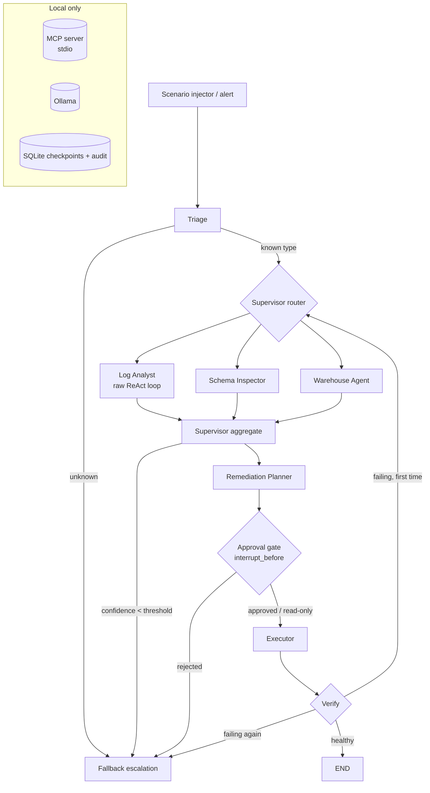

# Architecture — Pipeline Incident Response Agent
_Last reviewed: 2026-10-19 · Status: designed, not yet built — every entry below is (planned) until its story closes_

## Stack
| Layer | Technology | Version | Notes |
|---|---|---|---|
| Language | Python | 3.11+ (pin in S1) | |
| Orchestration | LangGraph | pin in S1 | StateGraph, conditional edges, interrupts |
| Persistence | LangGraph SQLite checkpointer + SQLite audit DB | pin in S1 | One thread_id per incident |
| Model serving | Ollama (OpenAI-compatible endpoint) | pin in S1 | Model chosen by S3 benchmark |
| Tool protocol | MCP (Python SDK), stdio transport | pin in S1 | Local server process |
| Mock warehouse | DuckDB | pin in S1 | Stand-in for Snowflake |
| Mock logs | JSON/text fixtures | — | 5 scenarios |
| Interface | CLI (Typer or argparse — decide in S1) | — | No web UI in v1 |
| Tests | pytest | — | |

## System overview
The scenario injector emits an alert. The LangGraph graph triages the alert and the supervisor routes it to specialist workers, which run in parallel and call tools discovered from the local MCP server. The supervisor aggregates their findings, then the planner drafts an ordered remediation plan. Before the executor runs, any gated step triggers an interrupt that waits for a human decision, stored in SQLite so it can be resumed hours later. The executor calls write tools, which only record to the fake job runner's audit log. The verify node then ends the incident, loops back once to re-diagnose, or escalates. Every node transition is checkpointed.



## Directory map (planned)
```
src/incident_agent/
  graph/       # StateGraph definition, nodes, routing functions, state schema
  agents/      # worker agents; log_analyst uses the raw loop
  raw_loop/    # framework-free ReAct loop, retries, max_iterations (no LangGraph imports)
  mcp_server/  # MCP server exposing read, metadata and write tools
  mcp_client/  # tool discovery and schema conversion
  mocks/       # DuckDB seed, log fixtures, fake job runner, scenario injector
  policy/      # risk tiers, approval rules, token budgets
  cli/         # run, approvals, checkpoints, fork commands
tests/
  unit/        # per-module tests
  e2e/         # one test per scenario
docs/          # this documentation set
```

## Key components
| Component | Responsibility | Depends on |
|---|---|---|
| Triage node | Classify an alert into an AlertType | Ollama |
| Supervisor router | Choose workers per alert type; handle the fallback route | IncidentState |
| Log Analyst | Iteratively read paginated logs to find the root cause (raw ReAct loop) | MCP log tools, Ollama |
| Schema Inspector | Detect source vs. warehouse schema drift | MCP metadata tools |
| Warehouse Agent | Check load audit, warehouse status, partition arrival | MCP warehouse tools |
| Aggregator | Merge findings into a single diagnosis with confidence; flag conflicts | findings reducer |
| Planner | Produce a schema-valid ordered plan with risk tiers | Ollama, policy |
| Approval gate | Interrupt before gated steps; show diff; record decision | policy, SQLite |
| Executor | Run plan steps in order; stop on failure | MCP write tools |
| Verify node | Re-check health; route to end, re-diagnose or escalate | MCP read tools |
| Fake job runner | Record write actions; simulate transient failures | SQLite audit DB |

### Routing table (FR-02)
| AlertType | Workers |
|---|---|
| SCHEMA_DRIFT | Log Analyst, Schema Inspector |
| AUTH_FAILURE | Log Analyst |
| WAREHOUSE_UNAVAILABLE | Warehouse Agent, Log Analyst |
| LATE_DATA | Warehouse Agent, Log Analyst |
| TRANSIENT_NETWORK | Log Analyst (retries are expected to resolve it) |
| UNKNOWN | Fallback |

## Data model
- **IncidentState** (LangGraph state)
  - `incident_id`, `alert`, `alert_type`
  - `messages` (reducer: add_messages)
  - `findings` (reducer: list append): each has worker, root_cause, evidence[], confidence
  - `diagnosis`: root_cause, confidence, conflicts[]
  - `plan`: ordered steps, each with tool, args, risk_tier, rationale
  - `step_results`, `retry_counts`, `verify_attempts`
  - `summary_note`: rolling summary for the sliding window
- **SQLite checkpoints**: managed by the LangGraph checkpointer, keyed by thread_id = incident_id.
- **audit_log** (SQLite): id, incident_id, action, args_json, risk_tier, approver, decision, timestamp.
- **Mock warehouse** (DuckDB): 3+ business tables and a `load_audit` table.

## External integrations
| System | Purpose | Auth method | Failure behaviour |
|---|---|---|---|
| Ollama (localhost) | LLM inference | None (local) | Retry once, then fail the node with a clear error |
| MCP server (stdio, local) | Tool discovery and execution | None (local process) | Transient → backoff retry; permanent → finding marked failed |
| DuckDB file | Mock warehouse | File path | Fail fast: a setup error, not an incident |

## Environments & config
- Env vars live in `.env` (gitignored); `.env.example` is committed. Keys: `MODEL_NAME`, `OLLAMA_BASE_URL`, `CHECKPOINT_DB`, `AUDIT_DB`, `WAREHOUSE_DB`, `MAX_ITERATIONS`, `CONFIDENCE_THRESHOLD`.
- Environments: local only. There is no dev or prod in v1.

## Architecture decisions (short form — detail in memory.md)
- Local models only — client data cannot leave the environment.
- Mocked backends — the project stays reproducible and no hallucinated write can touch real systems.
- The Log Analyst is a raw SDK loop wrapped as a node — this covers Day 16 mechanics inside a Day 17 graph.
- Tools go through MCP rather than direct imports — workers are scoped by which tools they're given.
